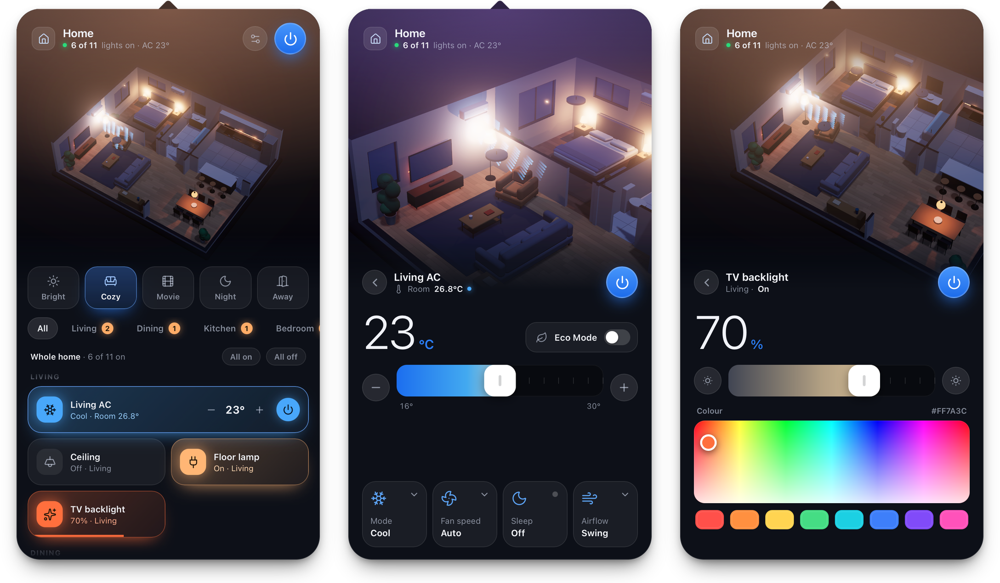
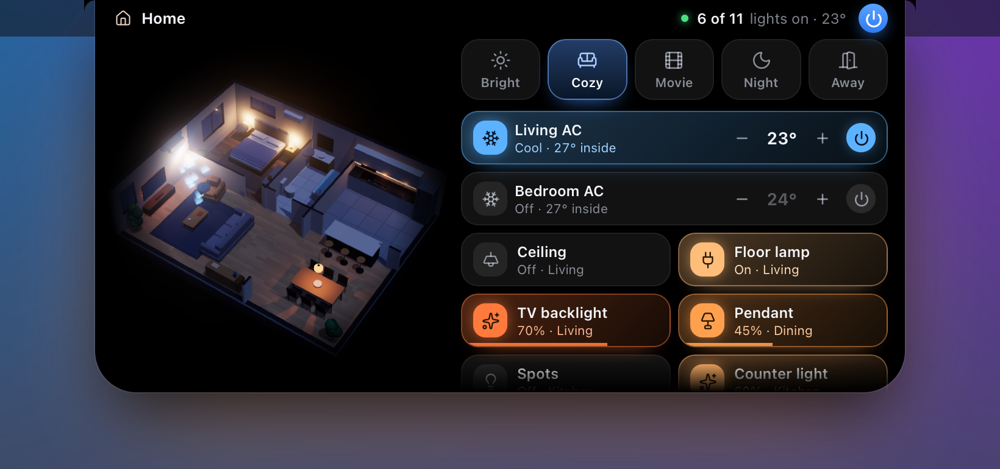
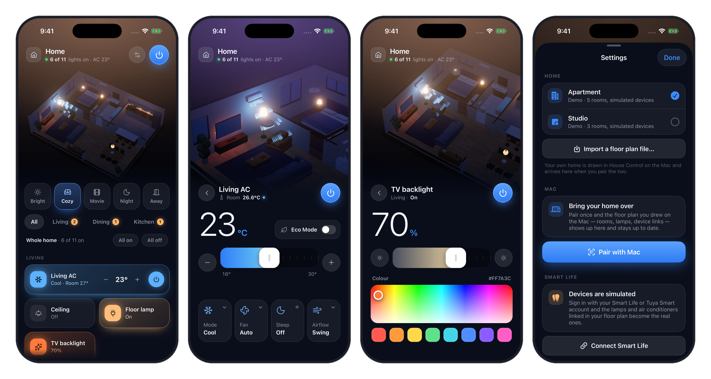
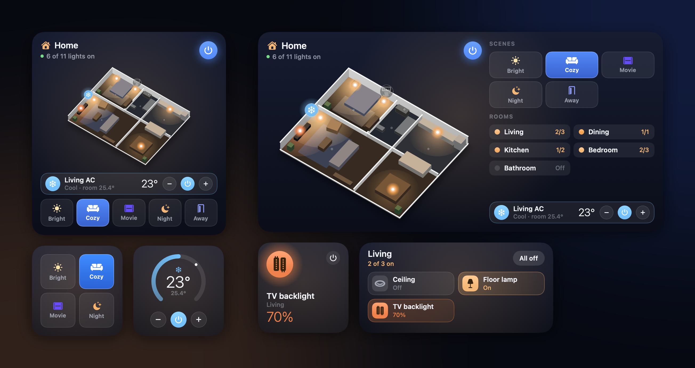
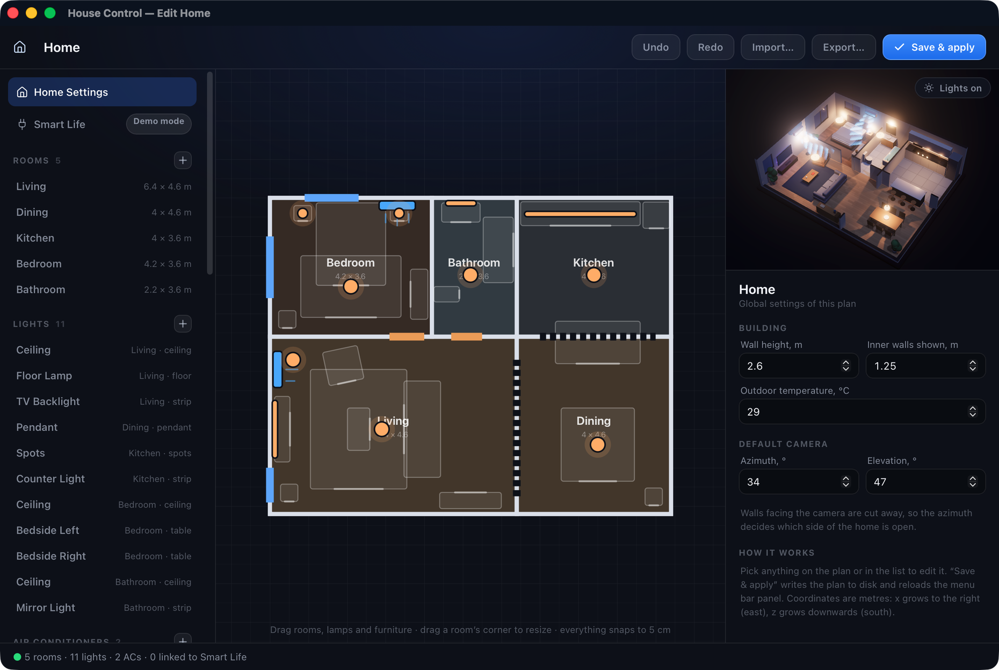
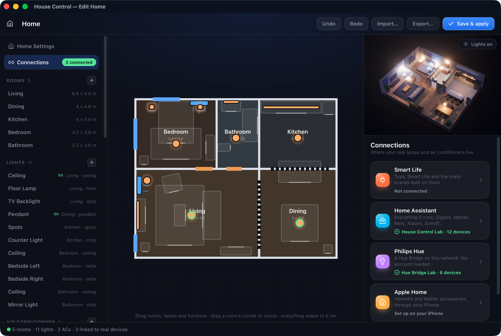

<p align="center">
  
</p>

<h1 align="center">House Control</h1>

<p align="center">
  Your home as a live 3D model — in the Mac's menu bar, around its notch and on your iPhone —<br>
  controlling its lights and air conditioners through Smart Life, Home Assistant, Philips Hue and Apple Home.
</p>

<p align="center">
  <a href="#download"><b>Download</b></a> &nbsp;·&nbsp;
  <a href="#build-and-run"><b>Build it yourself</b></a> &nbsp;·&nbsp;
  <a href="#support-the-project"><b>Support the project</b></a>
</p>

<p align="center">
  
</p>

## What it does

- **Lives in the menu bar.** Click the house icon and a panel drops down; click anywhere else and it is gone.
- **Your floor plan in 3D.** Rooms, walls, doors, windows and furniture are built from one JSON file.
  Lamps light the scene the way they light the room; an AC that is running blows visible air.
- **Lights.** Tap to toggle, drag across a tile to dim, open a light for brightness, white temperature and colour.
- **Air conditioners.** Power, target temperature, mode and fan speed, with the room temperature from a real sensor if you have one.
- **Scenes.** One tap sets every light and AC — "Cozy", "Movie", "Night", or your own.
- **A visual editor.** Draw the rooms, drop in furniture, place lamps and ACs, and link each one to a real device.
- **Your devices, wherever they live.** Smart Life / Tuya, Home Assistant (and the thousands of brands it runs),
  Philips Hue and Apple Home — mixed freely in one home. See [Connect real devices](#connect-real-devices).
- **An island around the notch.** Rest the pointer on the MacBook's notch and a small live model of the home drops
  out of it, with scenes and every device one click away. See [The island](#the-island).
- **AI Access.** Give ChatGPT, Claude or any AI assistant a private link — or connect it over MCP — and it runs your
  lights and air conditioners, and rebuilds rooms in the 3D model from your photos. Served by your Mac; Stop ends it.
  See [AI Access](#ai-access).
- **Widgets and controls.** The home in 3D on the iPhone's Home Screen and the Mac's desktop, scenes, lamps and
  air conditioners a tap away, Lock Screen and Control Center controls, and quick actions on the app icon.
  See [Widgets](#widgets).
- **An iPhone app that needs no Mac.** Draw the home, connect Smart Life, Home Assistant, Hue and Apple Home and
  link the devices, all on the phone. Pair a Mac later and both stay in sync, whichever one you edit.
  See [iPhone app](#iphone-app).
- **Works without any hardware.** Until you sign in, every device is simulated, so you can try everything first.

Both apps are a small native Swift shell (AppKit on the Mac, SwiftUI on the iPhone) around one
[Three.js](https://threejs.org) web UI, and share their device clients and sync as a Swift package.
No frameworks, no Electron, no server, no account of its own.

## Download

1. Get `HouseControl-<version>.dmg` from [Releases](https://github.com/0xProbabillity/house-control/releases).
   It runs on macOS 13 or newer, Apple silicon and Intel.
2. Open it and drag **House Control** into **Applications**.
3. Open **House Control** from Applications. The first time, macOS stops it with *“Apple could not verify…”*,
   because the app is not signed with a paid Apple Developer ID (see [why](#why-the-app-is-not-notarized)).
   Allow it once:
   - **macOS 15 Sequoia and newer:** click **Done**, open **System Settings → Privacy & Security**, scroll down
     to *“House Control was blocked…”*, click **Open Anyway** and confirm with your password.
   - **macOS 13–14:** Control-click the app in Applications, choose **Open**, then **Open** again.
   - Or, in Terminal: `xattr -dr com.apple.quarantine "/Applications/House Control.app"`
4. Look for the house in the menu bar — there is no Dock icon and no window. Click it.

What is new in each release: [CHANGELOG.md](CHANGELOG.md).

It starts with a bundled demo plan, so you can try everything before connecting anything. Then:
[make it your home](#make-it-your-home) and [connect real devices](#connect-real-devices).
To start it with your Mac, add it under **System Settings → General → Login Items**.

### Check what you downloaded

Every release image is built by [GitHub Actions](.github/workflows/release.yml) from the tagged commit — not on
anyone's Mac — and comes with its SHA-256 and a signed build provenance attestation:

```bash
shasum -a 256 -c HouseControl-<version>.dmg.sha256
gh attestation verify HouseControl-<version>.dmg --repo 0xProbabillity/house-control
```

The second command proves the image was built by this repository's workflow, and shows from which commit.
Images from 1.0.0 on carry an attestation; 0.1.0 was built while the repository was still private, when GitHub
does not store attestations for free accounts, so for it only the SHA-256 can be checked.

### Why the app is not notarized

Notarizing needs an Apple Developer ID, and that certificate carries a person's legal name inside every copy of
the app. House Control ships signed ad hoc instead, and earns trust the open-source way: the code is all here,
the release is built in public, and you can [build it yourself](#build-and-run) in a couple of minutes.

### Remove it

Quit it (right-click the menu bar icon → **Quit**), delete **House Control** from Applications and, to remove your
plan and connections too, `~/Library/Application Support/HouseControl/`.

## Requirements

| | |
| --- | --- |
| macOS | 13 Ventura or newer |
| Xcode Command Line Tools | Swift 5.9 or newer — `xcode-select --install` |
| Node.js | 20.19+ or 22.12+ |
| For the iPhone app | Xcode 16 or newer, [XcodeGen](https://github.com/yonaskolb/XcodeGen) (`brew install xcodegen`), iOS 17+ |

## Build and run

```bash
git clone https://github.com/0xProbabillity/house-control.git
cd house-control
./scripts/build-app.sh
open build/HouseControl.app
```

The script builds the web UI with Vite, the native shell with SwiftPM, and assembles an ad-hoc signed
`build/HouseControl.app`. The first build downloads the npm packages; later builds take a few seconds.

The app is signed ad hoc. If you rebuild often and use iPhone sync, sign it with your own certificate instead, so
macOS does not ask for the Local Network permission after every build:
`CODESIGN_IDENTITY="Apple Development: you@example.com (ABCDE12345)" ./scripts/build-app.sh`.

To keep it, drag `build/HouseControl.app` into `/Applications`. To start it with your Mac, turn on **Open at
Login** in **Settings** (⌘, or the menu bar icon's right-click menu → **Settings…**); it shows up under
**System Settings → General → Login Items**, where it can be switched off too.

There is no Dock icon and no main window: look for the house in the menu bar. Its **Settings** window (⌘, from any
House Control window, or **Settings…** in the right-click menu and the panel's gear menu) has everything in one place:
Open at Login and the island, your floor plans, Smart Life, Home Assistant, Hue and Apple Home, iPhone pairing,
AI Access and About.

## Using it

| Do this | To get this |
| --- | --- |
| Click the menu bar icon | Open or close the panel |
| Right-click the menu bar icon | Settings, Edit Home, Load Floor Plan, Reveal Plan File, Reveal Device Log, Show Island, Open at Login, Pair Phone, AI Access, Reload, Quit |
| `⌘,` | Settings |
| Click a lamp in the 3D view, or its tile | Toggle it |
| Drag sideways across a light tile | Dim it |
| Click the sliders icon on a light tile | Brightness, white temperature, colour |
| Click an AC, or its tile | Open its sheet: temperature, mode, fan speed |
| Click a room | Zoom in on it and list only its devices |
| Drag the 3D view / scroll over it | Rotate / zoom |
| `Esc` | Back, then close |

The menu bar icon shows how many lights are on and the target of the running AC, for example `6 · 23°`.

The gear button in the panel switches between your home and the two bundled demo plans, **Apartment** and **Studio**.

## The island

<p align="center">
  
</p>

A black tab grows out of the MacBook's notch. On a display without a notch it is drawn in the middle of the menu bar.

| Do this | To get this |
| --- | --- |
| Look at it | How many lights are on, and the target of a running AC |
| Rest the pointer on it | It springs open: the 3D model, scenes, air conditioners and lights |
| Click a lamp in the model, or its chip | Toggle it; drag across a chip to dim |
| Click a room in the model | Zoom in on it |
| Move the pointer away | It closes |

When something changes elsewhere — a scene picked in the panel, a lamp switched from the phone — the island
peeks out for a moment to say what happened. It never takes the keyboard from the app you are working in.
**Show Island** in the menu bar icon's right-click menu turns it off.

## AI Access

<p align="center">
  
</p>

Right-click the menu bar icon → **AI Access…** → **Start AI Access**, and hand the private link to an assistant:

- **Any chat:** paste it into ChatGPT, Claude, Gemini or Perplexity with your request — *"dim the living room to 30%"*.
  The link opens a guide written for AI assistants, with an action link for everything it can do.
- **Connectors:** add the MCP address as a custom connector in Claude or ChatGPT (or `claude mcp add` in Claude Code)
  and the assistant can also change the home itself: *"here are photos of my living room — rebuild it in 3D"*.
- **Your own agents:** the same tools as plain HTTP + JSON, with an OpenAPI description.

The Mac serves it all: House Control listens on `127.0.0.1` only and is reached through a Cloudflare quick tunnel that
exists while AI Access is on (or not at all, with **This Mac only**). The link carries a 128-bit key, you choose what an
assistant may do, every request shows up live in the window, plan edits can be undone, and **Stop** — or the
auto-stop timer — makes the address disappear. Device IDs and sign-ins never leave the Mac.

Details, every tool, and the privacy model: [docs/ai-access.md](docs/ai-access.md).

## iPhone app

<p align="center">
  
</p>

The iPhone app is the panel made for a thumb: tap a lamp in the 3D view or its tile, drag across a tile to dim,
touch and hold a light for brightness and colour, pinch the model to zoom, swipe in from the left edge to go back.

It needs no Mac. Everything is set up on the phone, under **Settings** (the sliders button):

- **New home** starts your own plan — one room, or the Studio or Apartment layout to adapt — and opens the editor.
- **Edit floor plan** is the Mac's editor laid out for a finger: tap a room, lamp or AC to select it, drag what is
  selected, drag anywhere else to pan, pinch to zoom. Its details come up in a sheet from the bottom; **Add**,
  **Items**, **3D** and **Home** sit along the bottom edge. **Save** keeps the plan on the phone (and sends it to a
  paired Mac).
- **Devices** lists every lamp and AC of the plan by room; tap one and pick its real device from everything your
  connected platforms have, or **Add devices to a room** to put several in at once, already linked.
- **Smart Life**, **Home Assistant**, **Philips Hue** and **Apple Home** connect right there. Home Assistant servers
  and Hue Bridges on the Wi-Fi are found by themselves.

Try it in the simulator:

```bash
./scripts/ios-sim.sh
```

To put it on a phone, write your Apple developer team into `ios/Config/Local.xcconfig`
(`DEVELOPMENT_TEAM = ABCDE12345`), run `cd ios && xcodegen generate --spec project-smartlife.yml`, open
`ios/HouseControl.xcodeproj` and run it on your device. `./scripts/build-ios.sh --upload` archives it and sends it to
TestFlight; the script lists what it needs.

The iPhone app comes in two editions, built from the same code:

| Edition | What it has | Built from |
| --- | --- | --- |
| **App Store** | Home Assistant, Philips Hue, Apple Home | `ios/project.yml` · `EDITION=appstore` |
| **Smart Life** | all of the above plus Smart Life / Tuya, for TestFlight and your own phone | `ios/project-smartlife.yml` (the scripts' default) |

Smart Life is reached through the sign-in Home Assistant's Tuya integration uses, not through an API Tuya offers to
apps, so it stays out of the App Store edition entirely: its code lives in its own module (`core/Sources/HouseSmartLife`)
that only the Smart Life edition and the Mac app link, and `build-ios.sh` refuses an App Store archive that contains it.
The two editions are separate apps (bundle id and App Group), so both can sit on one phone.

### iPhone Duo

Closed, the Duo runs the app like any iPhone. Open it and the app spreads across the inner display, one half each,
so the 3D model and the controls are never on top of each other:

- **Open flat, held sideways:** the home in 3D on the left half, scenes, rooms and devices on the right. A lamp or
  AC opens its controls on the right half while the model turns to it on the left.
- **Half-folded like a book:** the same, broken exactly at the fold. Nothing sits across the crease.
- **Half-folded like a laptop on a table:** the model stands on the upper half, facing you, and the controls lie on
  the lower half, under your thumb — a small home hub for the desk or the bedside.
- **Open flat, held upright:** the model above the crease, the controls below it, tiles three to a row.
- **Opening the phone** plays the camera sweep and the lights coming on, as when the app starts.
- **The floor plan editor** keeps the plan on the left half and the details of what you picked on the right,
  instead of in a sheet over the plan. Settings and the connection screens stay at a readable width.
- **Beside another app** the app can be resized, so it takes the shape it is given; narrower than 720 points, it
  stacks as on any iPhone.

To try it, run the app on the iPhone Duo simulator (Xcode 27.1 or newer) and fold it with the **Closed**,
**Partially Open** and **Open** buttons under the device in Device Hub:

```bash
DEVICE="iPhone Duo" ./scripts/ios-sim.sh
```

In a browser, `?platform=ios&fold=455,0,41,669` at 951×669 stands in for a Duo half-folded like a book, and
`fold=0,455,669,41` at 669×951 for one standing like a laptop.

The fold comes from the system's division region (`reservedRegions(kind: .division)`). The iPhone Duo simulator in
Xcode 27.1 reports none, so where there is none at all and the hinge says half open, the app takes the fold to run
down the middle of the screen ([FoldWebView.swift](ios/Sources/FoldWebView.swift)).

### Sync with a Mac or PC

Optional. Pair a Mac or a Windows PC and your floor plan — rooms, furniture, lamps, scenes and the links to real
devices — plus the Home Assistant and Hue connections stay the same on both, whichever one you set up or edit first.
[House Control for Windows](https://github.com/0xProbabillity/house-control-windows) pairs exactly like the Mac app.

1. On the computer: right-click the House Control icon — in the menu bar on a Mac, in the taskbar's tray on a PC —
   → **Pair Phone…** (**Pair iPhone…** in older versions). A QR code appears.
   macOS asks once whether House Control may find devices on your local network: allow it.
2. On the iPhone: **Settings** (the sliders button) → **Pair with Mac or PC**, and point the camera at the code.
   Or press **Copy Pairing Link** on the computer and paste it on the phone.

[House Control for Android](https://github.com/0xProbabillity/house-control-android) pairs with the same code.

From then on, whenever both are on the same Wi-Fi and the app is open, a plan saved on one reaches the other a
moment later. A home set up on the phone first goes to the computer when you pair them. If both changed the plan
while apart, the phone asks which one to keep. A Home Assistant or Hue Bridge connected, or disconnected, on either side
is the newest one on both.

Nothing goes through a server. The computer advertises itself with Bonjour (DNS-SD) and the two talk over TLS with a
pre-shared key that only the QR code carries, so a device that never saw the code cannot connect.
**Reset Pairing…** in the pairing window issues a new key.

### Real devices on the iPhone

In the Smart Life edition the phone signs in to Smart Life on its own: **Settings → Connect Smart Life**. The User Code is filled in from the
Mac if you are signed in there. The sign-in code has to be scanned by the Smart Life app, which is on the very phone
you are holding. So **Save code to Photos**, then in Smart Life tap **+ → Scan** and open the picture from its photo
button. A paired Mac also puts the code on its screen for you, and **Share code** sends it to any other screen.

The session is kept in the iPhone's Keychain and never leaves the device.

## Widgets

<p align="center">
  
</p>

Every widget is live: tap a lamp, a scene or an AC and it switches without opening the app.

- **Home** — your home as a small 3D model, every lamp glowing in its own colour; scenes, the climate strip and
  tappable lamps in the bigger sizes (extra large on the Mac).
- **Scenes**, **Light** (one lamp you pick), **Room** (its lamps; the large size shows the room alone in 3D) and
  **Climate** (an AC's dial with the room temperature, power and − / +).
- **Lock Screen:** Home Status, Light and Climate as circles, rectangles and an inline line.
- **Controls** for Control Center, the Lock Screen and the Action button (iOS 18, macOS 26): All Lights, a Light,
  a Scene, an Air Conditioner, and on the iPhone **House Control**, which opens the app.
- **Quick actions:** press and hold the app icon on the iPhone. Choose which scenes, lamps and ACs it offers in
  **Settings → Quick Actions**.

On the Mac they need the app running in the menu bar (it carries out what you tap); on the iPhone the widget talks
to Home Assistant, Hue and Smart Life itself, and Apple Home devices switch when the app next opens. How it fits
together, and how to build and try it: [docs/widgets.md](docs/widgets.md).

## Make it your home

Right-click the icon and choose **Edit Home…**

<p align="center">
  
</p>

- Drag rooms to move them and drag a corner to resize; everything snaps to 5 cm.
- Where two rooms touch, the wall between them appears by itself. Walls facing the camera are cut away.
- Add doors, windows, furniture, lamps and air conditioners from the list on the left.
- **Save & apply** writes the plan and reloads the panel.

The plan is a single JSON file, `~/Library/Application Support/HouseControl/plan.json`. You can write it by hand,
export it, or import someone else's: see [docs/floor-plan.md](docs/floor-plan.md) for every field.
The demo plans in [`web/public/plans`](web/public/plans) are good starting points.

## Connect real devices

<p align="center">
  
</p>

Right-click the icon → **Edit Home… → Connections**, and connect what you have:

| Platform | How | Details |
| --- | --- | --- |
| **Smart Life / Tuya** | Scan a QR code with the Smart Life app. No Tuya developer account | [docs/smart-life.md](docs/smart-life.md) |
| **Home Assistant** | Found on your network by itself; paste a long-lived access token | [docs/connections.md](docs/connections.md#home-assistant) |
| **Philips Hue** | Found on your network by itself; press the button on the bridge | [docs/connections.md](docs/connections.md#philips-hue) |
| **Apple Home** | Allow access on your iPhone; its devices are listed on the Mac for linking | [docs/connections.md](docs/connections.md#apple-home) |

Then select a lamp or an AC on the plan, choose its device under **Real device** (lamps take over what the
device can do), and press **Save & apply**. From then on the panel controls the real device. Changes made
elsewhere show up at once from Home Assistant and Hue, and within 12 seconds from Smart Life.

Your iPhone receives the Home Assistant and Hue connections from the Mac with the floor plan, and switches
Apple Home devices itself. Why there is no Google Home or Alexa yet, and how to get Tuya devices into Apple Home:
[docs/connections.md](docs/connections.md). No hardware at hand? [`tools/lab`](tools/lab/README.md) has pretend
versions of Home Assistant, a Hue Bridge and a HomeKit bridge.

## Privacy

House Control talks to the platforms you connect — Tuya's servers for Smart Life, your own Home Assistant,
your Hue Bridge, Apple Home on the iPhone — and to nothing else. There is no telemetry and no backend of its own.
The one exception is yours to switch on: [AI Access](#ai-access) opens a Cloudflare tunnel to your Mac while it is on.

Everything personal stays in `~/Library/Application Support/HouseControl/` on your Mac:

| File | Contents |
| --- | --- |
| `plan.json` | Your floor plan, including the IDs of the devices you linked |
| `settings.json` | Which plan is active |
| `smartlife.json` | The Smart Life session tokens. Readable only by you (mode `600`) |
| `tuya.json` | Tuya Cloud project credentials, only if you use that option. Mode `600` |
| `homeassistant.json` | Your Home Assistant's address and access token. Mode `600` |
| `hue.json` | Your Hue Bridge's address, the key it issued and its certificate's fingerprint. Mode `600` |
| `homekit-devices.json` | The Apple Home devices your iPhone listed for the editor: names and ids |
| `events.log` | Commands sent to real devices and the cloud's answers. No tokens |
| `sync.json` | The key your paired iPhones use. Only there once you paired one. Mode `600` |
| `cloudflared.yml`, `bin/cloudflared` | An empty config for AI Access's tunnel, and Cloudflare's connector if you let the app download it |

None of these are part of this repository, and the build does not embed them in the app.
**Sign out** in the editor deletes `smartlife.json`. Deleting the folder resets the app to the demo plan.

On the iPhone the floor plan lives in the app's own folder, and the Smart Life session, the pairing key and the
Home Assistant and Hue connections the Mac shared live in the Keychain.

## Development

```
web/      the UI: Three.js scene, panel, island, editor, AI Access window and the AI tools (Vite, plain ES modules)
core/     what both apps share: plan store, device platforms, Mac ⇄ iPhone sync, the AI gateway, and the Smart Life
          and Tuya clients as a separate module (SwiftPM, with tests)
macos/    the Mac shell: menu bar item, panel, island and editor windows (SwiftPM)
ios/      the iPhone shell: SwiftUI, generated into an Xcode project by XcodeGen
scripts/  build-app.sh, build-ios.sh and ios-sim.sh build the apps, release-mac.sh makes the .dmg,
          make-icon.swift and make-dmg-background.swift draw the icon and the disk image's window
tools/lab pretend Home Assistant, Hue Bridge and HomeKit bridge for testing without hardware
docs/     floor plan reference, connection guides, screenshots
```

The shared package has unit tests, including the sync over a real TLS connection:

```bash
cd core && swift test
```

Work on the UI in a browser with hot reload — the native bridge is a no-op there and all devices are simulated:

```bash
cd web
npm install
npm run dev
```

Then open `http://localhost:5199/`. Add `?plan=studio` for the second demo plan, `?mode=editor` for the editor,
`?mode=island` for the island, `?mode=agent` for the AI Access window (with a simulated link), `?platform=ios` for the iPhone layout, or `?device=living.ac` to start on a
device's sheet. Set `PORT` to use another port.

Environment variables understood by the app:

| Variable | Effect |
| --- | --- |
| `HOUSE_DEV_URL=http://localhost:5199/` | Load the UI from the dev server instead of the bundle |
| `HOUSE_WEB_DIR=/path/to/dist` | Load the UI from another folder |
| `HOUSE_DATA_DIR=/some/folder` | Keep plan, session and log there instead of Application Support, and do not persist panel state. Handy for a clean test run |
| `HOUSE_OPEN_ON_LAUNCH=1` | Open the panel at launch |
| `HOUSE_OPEN_EDITOR=1` | Open the editor at launch (`connections`, `smartlife`, `homeassistant`, `hue` or `homekit` opens it on that screen) |
| `HOUSE_OPEN_DEVICE=<id>` | Start the panel on that light's or AC's sheet |
| `HOUSE_PIN=1` | Keep the panel open when it loses focus |
| `HOUSE_DOCK=1` | Show a Dock icon, so UI automation tools can see the app |
| `HOUSE_ISLAND=0` | Run without the island (`1` forces it on) |
| `HOUSE_ISLAND_EXPANDED=1` | Keep the island open |
| `HOUSE_OPEN_PAIRING=1` | Open the Pair Phone window at launch |
| `HOUSE_COMPUTER_NAME="Studio Mac"` | The name paired iPhones see, instead of the Mac's own (screenshots) |
| `HOUSE_SNAPSHOT_DIR=/some/folder` | Write `panel.png` and `island.png` there a few seconds after launch |
| `HOUSE_RENDER_HIDDEN=1` | Keep drawing while the screen is locked, for unattended captures |
| `HOUSE_OPEN_AGENT=1` | Open the AI Access window at launch (`start` also starts the link) |
| `HOUSE_AGENT_REACH=local` | Serve AI Access on this Mac only for one run (`internet` for the tunnel) |
| `HOUSE_AGENT_LINK_FILE=/some/file` | Write the live AI Access link there, for scripted tests |
| `HOUSE_EVAL_DIR=/some/folder` | Scripted UI checks: a `panel.js` / `editor.js` / `island.js` dropped there runs in that page (as an async function body) and its result is written to `<mode>.json` |

The iPhone app understands `HOUSE_DATA_DIR`, `HOUSE_OPEN_DEVICE`, `HOUSE_SYNC_ENDPOINT=host:port` (a Mac test instance
without Bonjour) and `HOUSE_SCREEN=home|settings|connections|pairing|smartlife|homeassistant|hue|devices|newhome|editor|welcome`;
`scripts/ios-sim.sh` passes any `HOUSE_*` variable on to the simulator.

For example, a throw-away instance on the demo plan, pinned open:

```bash
HOUSE_DATA_DIR=/tmp/house-demo HOUSE_PIN=1 HOUSE_OPEN_ON_LAUNCH=1 build/HouseControl.app/Contents/MacOS/HouseControl
```

The binary has a few offline self-checks and one read-only diagnostic:

| Command | Prints |
| --- | --- |
| `HouseControl --selftest-mapper` | The Tuya commands built for typical light and AC actions |
| `HouseControl --selftest-infrared` | The key presses sent to an infrared AC, against a simulated cloud remote |
| `HouseControl --selftest-transport` | The Smart Life request envelope for fixed inputs, to compare with the reference SDK |
| `HouseControl --diagnose <device id>…` | What Smart Life reports for those devices. Reads only; sends nothing |

### Releasing the Mac app

Set `MARKETING_VERSION` in `ios/Config/Base.xcconfig`, add a `## <version> — <date>` section to
[CHANGELOG.md](CHANGELOG.md) (it becomes the release notes), commit, then tag and push:

```bash
git tag v1.0.0 && git push origin v1.0.0
```

[`release.yml`](.github/workflows/release.yml) builds the universal app on a GitHub macOS runner
(`UNSIGNED=1 ./scripts/release-mac.sh`), attests its provenance and opens a **draft** release with the disk image
and its SHA-256. Check it, then publish the draft. Running the workflow by hand from the Actions tab builds the same
image as a downloadable artifact without a release.

With an Apple Developer ID of your own, `ASC_KEY_ID=… ASC_ISSUER_ID=… ./scripts/release-mac.sh --publish` builds a
signed and notarized image locally instead; the script lists what it needs.

## Limitations

- The iPhone app is not on the App Store yet (it is on TestFlight for the author's testers).
- The Mac and the iPhone sync only while both are on the same network; there is no cloud in between.
- Rooms are axis-aligned rectangles. An L-shaped room is two rooms.
- Apple Home devices are switched by the iPhone app only: macOS gives HomeKit to App Store apps only.
- Smart Life devices are reached through Tuya's cloud, not over the local network, so they need an internet
  connection (Home Assistant and Hue work on your network alone).
- Infrared air conditioners are one-way: the app shows what was last sent, not what the unit is doing.

## Support the project

<picture>
  <source media="(prefers-color-scheme: dark)" srcset="docs/support/banner-dark.svg">
  <source media="(prefers-color-scheme: light)" srcset="docs/support/banner-light.svg">
  
</picture>

House Control is free and has no ads. If it earned a place in your menu bar, a tip in crypto
helps it keep growing: more devices, more platforms, quicker fixes. Thank you! A star, a bug report or a
pull request helps just as much.

Scan a code with your wallet, or copy an address with the button in the corner of its box.

> [!IMPORTANT]
> Send each coin only over the network named next to its address. Coins sent over another network may be lost.

<table>
  <tr>
    <td align="center" width="196">
      
    </td>
    <td>
      &nbsp;
      <b>Bitcoin</b>
      <br><sub>BTC · native SegWit (bech32) address</sub>

```text
bc1q07hfz95crdalcrnywjavdpc4pdvllct83as5re
```

</td>
  </tr>
  <tr>
    <td align="center" width="196">
      
    </td>
    <td>
      
      
      
      &nbsp;
      <b>Ethereum · Base · BNB Chain · Arbitrum</b>
      <br><sub>One address on all four networks · ETH, BNB, USDT, USDC and other tokens</sub>

```text
0x4ed3aF428e938a0CC8e60df86D714B4a7F0928F0
```

</td>
  </tr>
  <tr>
    <td align="center" width="196">
      
    </td>
    <td>
      &nbsp;
      <b>TON</b>
      <br><sub>Toncoin and USDT on TON · no memo needed</sub>

```text
UQBCDKDp11tBIwTon4ItzTPcQgNGcaqTM6Gn31KwSN7qWdmM
```

</td>
  </tr>
  <tr>
    <td align="center" width="196">
      
    </td>
    <td>
      &nbsp;
      <b>TRON</b>
      <br><sub>TRX and USDT (TRC-20)</sub>

```text
TWtWLJp2Hc6242RynhU1B4Uujru3tppb3B
```

</td>
  </tr>
</table>

## Acknowledgements and disclaimer

The Smart Life sign-in is a Swift port of Tuya's open-source
[`tuya-device-sharing-sdk`](https://github.com/tuya/tuya-device-sharing-sdk), the library behind the Tuya
integration in Home Assistant, and identifies itself to Tuya the same way. The 3D view is built with
[Three.js](https://threejs.org); the icons are from [Lucide](https://lucide.dev), the network logos under
[Support the project](#support-the-project) from [Web3 Icons](https://github.com/0xa3k5/web3icons) (MIT).

This project is not affiliated with or endorsed by Tuya, Smart Life or Home Assistant. It relies on an
interface Tuya can change at any time. Use it at your own risk.

## License

[MIT](LICENSE)
