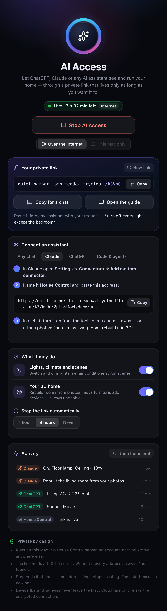

# AI Access

Give ChatGPT, Claude or any other AI assistant a private link to your home. It can then see every room, switch and
dim the lights, run the air conditioners and scenes — and change the 3D model itself: send it photos of your living
room and ask it to rebuild the room, or tell it you moved the sofa.

There is no House Control server and no account. Your Mac answers the assistant itself, through a tunnel that exists
only while AI Access is on.

<p align="center">
  
</p>

## Start

1. Right-click the menu bar icon → **AI Access…** (or the gear in the panel → **AI access…**).
2. Press **Start AI Access**. A few seconds later the window shows your private link.
3. Hand it to an assistant — see [Connect an assistant](#connect-an-assistant).

While the link is live, sparkles appear next to the house in the menu bar and an **AI** badge in the panel.
Everything an assistant reads or does shows up in the window's **Activity** feed as it happens, and the panel and
the island at the notch show each change with sparkles.

**Stop AI Access** ends it at once. Each start makes a new link; an old one never works again.

## How it works

```
assistant ──HTTPS──▶ Cloudflare quick tunnel ──▶ cloudflared on your Mac ──▶ 127.0.0.1 (House Control) ──▶ your devices
```

- House Control listens on the loopback interface only (port 7419, or any free one). Nothing on your network sees it.
- To be reachable from ChatGPT's or Claude's servers, the Mac opens a free
  [Cloudflare Quick Tunnel](https://developers.cloudflare.com/cloudflare-one/connections/connect-networks/do-more-with-tunnels/trycloudflare/):
  a random `https://….trycloudflare.com` address that exists while `cloudflared` runs. No Cloudflare account is needed.
  If `cloudflared` is not installed (`brew install cloudflared`), the window offers to download it from Cloudflare's
  GitHub releases and keeps it only if it carries Cloudflare's Developer ID signature.
- Every address carries a random 128-bit key: `https://….trycloudflare.com/<key>/…`. Without the key, every path
  answers 404.
- **This Mac only** skips the tunnel: the link is `http://127.0.0.1:7419/<key>`, for apps running on the Mac
  (Claude Code, Cursor, VS Code, LM Studio, scripts).

## Connect an assistant

### Any chat (paste the link)

Press **Copy for a chat** and paste it into ChatGPT, Claude, Gemini, Perplexity or Grok together with what you want:

> You can control my home with House Control. Open this private link and follow its instructions: https://….trycloudflare.com/k3Vb…
> Dim the living room to 30% and cool the bedroom to 22°.

The link opens a guide written for AI assistants: the rules, the state of every device, and a ready-made **action link**
for each thing it can do (`…/do/light/living.main/brightness/30`). Opening an action link performs it and answers
with the new state, so even an assistant that can only browse can run the home.

Changing the 3D model needs more than opening links. For that, connect House Control as a connector:

### Claude

**Settings → Connectors → Add custom connector**, name it *House Control*, and paste the **MCP address** from the
**Claude** tab (`https://….trycloudflare.com/<key>/mcp`). In a chat, enable it from the tools menu. Attach photos and ask
*"here is my living room — rebuild it in 3D"*.

### ChatGPT

**Settings → Apps & Connectors → Advanced → Developer mode**, then **Create** a connector with the MCP address and
**No authentication**. In a chat, pick Developer mode and add House Control.

### Claude Code, Cursor and other MCP clients

```bash
claude mcp add --transport http house-control https://….trycloudflare.com/<key>/mcp
```

```json
{ "mcpServers": { "house-control": { "url": "https://….trycloudflare.com/<key>/mcp" } } }
```

### Your own agent or script

The same tools as plain HTTP with JSON:

| Request | Does |
| --- | --- |
| `GET  /<key>/` | The guide (Markdown), with the current state and every action link |
| `GET  /<key>/api/tools` | The tools with their JSON schemas |
| `POST /<key>/api/<tool>` | Runs a tool; the body is its arguments. Answers `{"ok", "result", "data", "image"}` |
| `GET  /<key>/openapi.json` | OpenAPI 3.1 for the above (Custom GPT actions, agent frameworks) |
| `GET  /<key>/plan.json` | The floor plan |
| `GET  /<key>/do/…` | The action links |
| `POST /<key>/mcp` | Model Context Protocol, Streamable HTTP (JSON responses, no server-sent events) |

```bash
curl -X POST https://….trycloudflare.com/<key>/api/set_lights -d '{"lights": ["living"], "brightness": 40}'
```

## What an assistant can do

| Tool | Does |
| --- | --- |
| `get_home` | Every room with its lights and ACs, what each can do and what it is doing, and the scenes |
| `set_lights` | On, off, toggle, brightness (%), white temperature (K), colour — for ids, whole rooms, names or `all` |
| `set_air_conditioners` | On, off, target temperature, mode, fan speed |
| `activate_scene` | Runs a scene |
| `get_floor_plan` | The plan behind the 3D model, the coordinate rules and the furniture catalogue |
| `edit_floor_plan` | A list of operations applied together: `furnish_room` (replace everything in a room — the photo case), add / update / remove rooms, furniture, doors and windows, lights, ACs and scenes |
| `replace_floor_plan` | A whole new plan, e.g. drawn from a sketch |
| `undo_floor_plan_edit` | Puts back the plan as it was before the last change |
| `render_home` | A picture of the 3D model, whole or one room, so the assistant can check its work |

Edits are checked before they are saved (unknown furniture, overlapping ids, rooms that do not add up are refused with
a reason the assistant can act on). The model on your screen updates at once, paired iPhones receive it, and
**Undo home edit** in the window — or the assistant itself — reverts it.

## What it may do

The **What it may do** switches take effect immediately, even while the link is live:

- **Lights, climate and scenes** — off makes the link read-only for devices.
- **Your 3D home** — off hides the editing tools.
- **Stop the link automatically** after 1 hour, 8 hours (the default) or never.

## Privacy and safety

- Anyone who has the link can do what the switches allow until you stop it. Treat it like a house key; the guide tells
  assistants never to repeat it. When in doubt, press **New link**.
- The assistant's provider (OpenAI, Anthropic…) sees what the assistant reads: room and device names and their state,
  and the floor plan. It never sees your Smart Life sign-in or the IDs of your real devices — those are replaced by
  `"linked": true`, and a plan the assistant writes keeps them as they were. Devices linked to real hardware cannot be
  removed through the link.
- Cloudflare relays the connection: HTTPS from the assistant to Cloudflare, an encrypted tunnel from Cloudflare to your
  Mac. Like any HTTPS proxy, Cloudflare's edge handles the traffic in between. Use **This Mac only** when the assistant
  runs on the Mac itself.
- Nothing about AI Access is stored except your three settings. The link exists only in memory; a `cloudflared` left
  over after a crash is stopped at the next launch.
- Requests are rate-limited (240 a minute) and bodies are capped at 4 MB.

## Troubleshooting

| Symptom | Cause |
| --- | --- |
| "Cloudflare is limiting new quick tunnels" | Quick tunnels are rate-limited per IP. Wait a minute and start again |
| The assistant says it cannot open the link | Some chat modes only open pages they found by searching. Paste the link on its own line, ask it to open it, or use a connector |
| The assistant opened the guide but not the action links | Ask it to open the link for that action — or connect it as an MCP connector |
| A connector stopped working | The link changed: every start makes a new one. Paste the new MCP address into the connector |
| "The user is looking at a demo plan" | Your own home is saved but a demo is shown; pick **My home** in the panel's gear menu |

For testing, `HOUSE_OPEN_AGENT=1` opens the window at launch (`start` also starts it), `HOUSE_AGENT_REACH=local|internet`
overrides the saved reach for one run, and `HOUSE_AGENT_LINK_FILE=<path>` writes the live link to a file.
