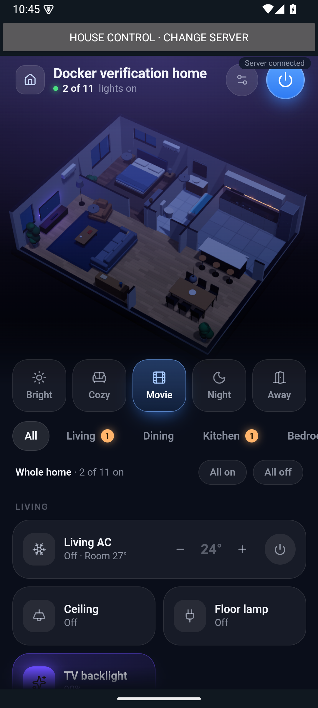
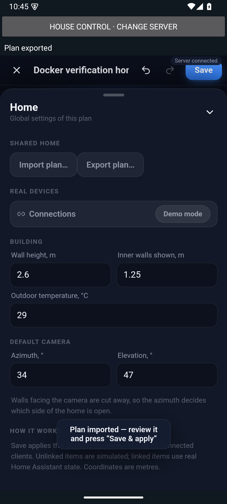
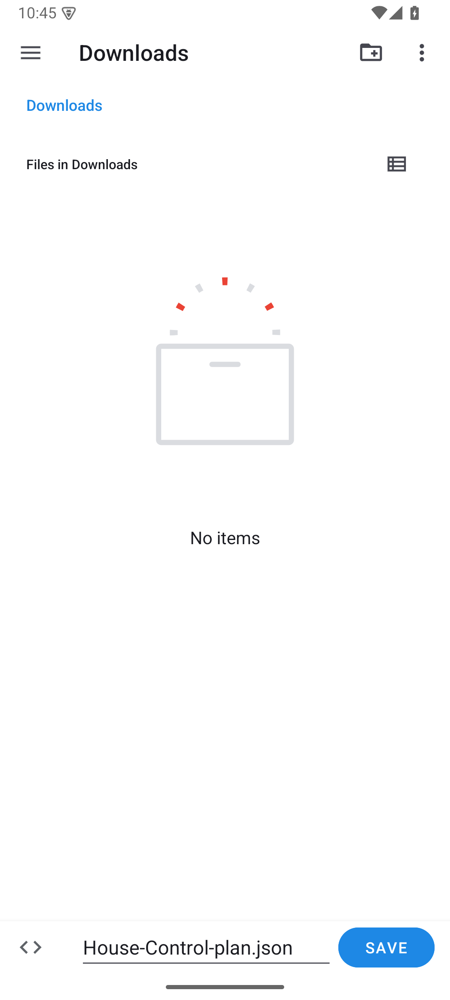

# Android screenshots and Docker resource sample

## Android app

These are original screenshots from the earlier API 35 Google APIs ARM64 Pixel 6 emulator verification. They show the development app using a demo floor plan served by Docker. They are emulator captures, not screenshots from a physical phone or proof of real-light control.

| Shared 3D home | Imported plan ready to review | Native JSON export picker |
| --- | --- | --- |
|  |  |  |

The screenshots are copied without editing. [Image hashes and capture notes](android-screenshots.json) record their provenance. These captures precede the final export-status toast adjustment; they should not be presented as fresh screenshots of the final commit. Subsequent live Home Assistant testing and physical-phone APK installation are described separately in the PR.

## Docker resource use

Ten samples were collected over approximately 23 seconds on 19 October 2026, **11:57:25–11:57:48 BST** (10:57 UTC). The existing server was running on Linux/arm64 in Colima on macOS, using Node v24.22.0, connected to Home Assistant with browser/emulator clients. No synthetic load or device commands were generated for this measurement.

| Docker metric | Minimum | Median | Maximum |
| --- | ---: | ---: | ---: |
| Memory | 29.49 MiB | 29.50 MiB | 29.51 MiB |
| CPU | 0.00% | 0.00% | 0.06% |
| PIDs (Docker field) | 11 | 11 | 11 |

These are **container-only observations**, excluding the Colima VM, macOS, Android emulator/phone and the client's 3D rendering. They describe this short observation window, not startup peaks, a load test, a minimum-RAM requirement or expected performance on other hardware. No explicit container memory limit was configured; the displayed 1.914 GiB limit is the memory available to Docker, not this application's consumption.

The [raw samples and environment metadata](docker-resources.json) were collected with `docker stats --no-stream --format json`, scoped to the House Control container. Docker's Linux CLI subtracts cache from its memory usage figure; it is not the same as process RSS or total host memory. See the [Docker statistics reference](https://docs.docker.com/reference/cli/docker/container/stats/).

To observe your own deployment without changing it, run this from its Compose directory:

```sh
docker compose stats --no-stream house-control
```

Omit `--no-stream` for a live view, and press Ctrl+C to stop watching. This does not stop the service.
