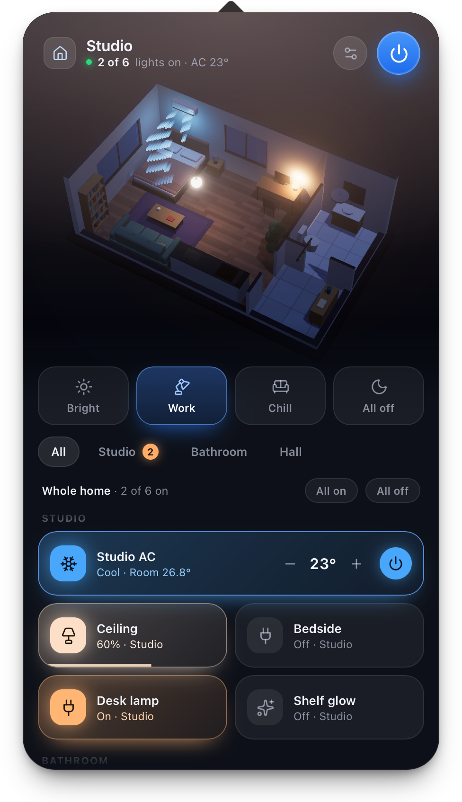

# The floor plan file

A home is one JSON document. The 3D scene, the panel and the editor are all built from it, so swapping the
file swaps the home.

- Your plan: `~/Library/Application Support/HouseControl/plan.json`
- Bundled demos: [`web/public/plans/home.json`](../web/public/plans/home.json) and
  [`studio.json`](../web/public/plans/studio.json)

You rarely need to write it by hand — **Edit Home…** does it for you — but it is plain, stable and easy to
generate or version. Load a file with **Load Floor Plan…** in the menu bar icon's right-click menu, or with
**Import…** in the editor.

<p align="center">
  
</p>

## Coordinates

Everything is in metres, seen from above: `x` grows to the right (east), `z` grows downwards (south).
Heights (`y`, `sill`, `head`) are metres above the floor. Angles are degrees.

## A complete small example

```jsonc
{
  "name": "Home",
  "wallHeight": 2.6,
  "interiorWallHeight": 1.25,
  "outdoorTemp": 29,
  "camera": { "azimuth": 34, "elevation": 47 },

  "rooms": [
    { "id": "living", "name": "Living", "rect": [0, 0, 6.4, 4.6], "floor": "oak" },
    { "id": "bath",   "name": "Bathroom", "rect": [6.4, 0, 2.2, 3.6], "floor": "tile" }
  ],

  "openings": [
    { "type": "door",   "from": [6.4, 1.0], "to": [6.4, 1.9] },
    { "type": "window", "from": [0, 1.0],   "to": [0, 2.6], "sill": 0.85, "head": 2.1 }
  ],

  "furniture": [
    { "type": "sofa", "pos": [3.9, 2.4], "rot": -90, "width": 2.5, "color": "#8b93a7" },
    { "type": "rug",  "pos": [2.6, 2.4], "size": [2.4, 1.6] }
  ],

  "lights": [
    { "id": "living.main", "name": "Ceiling", "room": "living", "type": "ceiling", "pos": [2.9, 2.3],
      "capabilities": ["brightness", "temp"] },
    { "id": "living.floor", "name": "Floor lamp", "room": "living", "type": "floor", "pos": [5.8, 0.6] },
    { "id": "living.tv", "name": "TV backlight", "room": "living", "type": "strip", "pos": [0.13, 2.3],
      "y": 1.05, "rot": 90, "length": 1.5, "capabilities": ["brightness", "color"], "color": "#7b5cff" }
  ],

  "acs": [
    { "id": "living.ac", "name": "Living AC", "room": "living", "wall": "west", "pos": [0, 0.8], "y": 2.2 }
  ],

  "scenes": [
    { "id": "movie", "name": "Movie", "icon": "film",
      "lights": { "*": { "on": false }, "living.tv": { "on": true, "brightness": 0.9, "color": "#6a4cff" } },
      "acs": { "*": { "target": 23 } } }
  ]
}
```

## Top level

| Field | Default | Meaning |
| --- | --- | --- |
| `name` | `"Home"` | Shown in the panel header |
| `wallHeight` | `2.6` | Height of the outer walls |
| `interiorWallHeight` | `1.25` | How much of the inner walls is drawn, so they do not hide the rooms |
| `outdoorTemp` | `27` | Used to estimate the room temperature of an AC that has no sensor |
| `camera.azimuth`, `camera.elevation` | `34`, `47` | Default view. Walls facing the camera are cut away, so the azimuth decides which side is open |

## `rooms`

| Field | Meaning |
| --- | --- |
| `id` | Unique. Lights and ACs refer to it |
| `name` | Shown in the room filter |
| `rect` | `[x, z, width, depth]` |
| `floor` | `oak`, `walnut`, `tile` or `stone` |

Rooms are rectangles. Where two of them touch, an inner wall appears on its own; make an L-shaped room out of two.

## `openings`

A gap in a wall, given by its two end points on that wall. It must be horizontal or vertical.

| Field | Meaning |
| --- | --- |
| `type` | `door`, `window`, or `open` (a doorway without a door, or a missing piece of wall) |
| `from`, `to` | `[x, z]` end points |
| `sill`, `head` | Bottom and top of a window. Defaults `0.85` and `2.1` |

## `furniture`

Decoration only. Every piece has `type`, `pos` (`[x, z]` of its centre) and an optional `rot`.

| `type` | Extra options |
| --- | --- |
| `sofa` | `width`, `color` |
| `armchair` | `color` |
| `coffeeTable` | `width` |
| `rug` | `size` (`[width, depth]`), `color` |
| `tv`, `sideboard`, `dresser`, `desk`, `vanity` | `width` |
| `diningSet` | `width`, `chairs` |
| `island` | `width`, `stools` |
| `kitchen` | `width`, `upper` (wall cabinets, `true` by default) |
| `bed` | `width`, `color` |
| `wardrobe`, `bookshelf` | `width`, `height` |
| `plant` | `height` |
| `fridge`, `nightstand`, `bathtub`, `toilet` | — |

## `lights`

| Field | Meaning |
| --- | --- |
| `id` | Unique |
| `name` | Shown on the tile |
| `room` | The `id` of its room |
| `type` | `ceiling`, `pendant`, `spots`, `floor`, `table` or `strip` |
| `pos` | `[x, z]` |
| `y` | Height, if the default for the type does not fit |
| `rot` | Rotation, for strips and spots |
| `length` | Length of a `strip` |
| `capabilities` | Any of `brightness`, `temp`, `color`. Leave it out for a plain smart plug that only switches |
| `color` | Initial colour of a colour light |
| `link`, `tuya` | Link to a real device — see below |

## `acs`

| Field | Meaning |
| --- | --- |
| `id`, `name`, `room` | As for lights |
| `wall` | The wall it hangs on: `north`, `south`, `east` or `west` |
| `pos` | `[x, z]`, on that wall |
| `y` | Height. Default `2.2` |
| `min`, `max` | Range of the target temperature. Defaults `16` and `30` |
| `link`, `tuya` | Link to a real device — see below |
| `sensor` | A thermometer for the room — see below |

## `scenes`

| Field | Meaning |
| --- | --- |
| `id`, `name` | Unique id and the label of the button |
| `icon` | `sun`, `sofa`, `film`, `moon`, `door`, `table`, `bed`, `tv` or `sparkles` |
| `lights` | Light id → what to set: `on`, `brightness` (0–1), `temp` (2200–6500 K), `color` (`#rrggbb`) |
| `acs` | AC id → what to set: `on`, `target`, `mode` (`cool`, `heat`, `dry`, `fan`, `auto`), `fan` (`auto`, `low`, `medium`, `high`, `turbo`) |

In both maps the key `"*"` applies to every device, and a device's own entry overrides it.

## Linking real devices

A light or an AC becomes real when it is linked to a device of a connected platform. The editor fills the link
in when you pick a device under **Real device**; by hand it looks like this:

```jsonc
// Home Assistant (an entity id), Philips Hue (the bridge's light id), Apple Home (HomeKit's service id)
{ "id": "living.floor", "name": "Floor lamp", "room": "living", "type": "floor", "pos": [5.8, 0.6],
  "link": { "service": "homeassistant", "id": "light.floor_lamp" } }

// An AC with a thermometer from any platform for its room temperature
{ "id": "living.ac", "name": "Living AC", "room": "living", "wall": "west", "pos": [0, 0.8],
  "link": { "service": "homeassistant", "id": "climate.living_room" },
  "sensor": { "service": "hue", "id": "<id of a Hue motion sensor's thermometer>" } }

// Smart Life keeps its own object
{ "id": "bed.ac", "name": "Bedroom AC", "room": "bedroom", "wall": "north", "pos": [2, 0],
  "tuya": { "deviceId": "<device id>", "sensorId": "<id of a Smart Life temperature sensor in the room>" } }
```

| Field | Meaning |
| --- | --- |
| `link.service` | `homeassistant`, `hue` or `homekit` |
| `link.id` | The device on that platform |
| `sensor` | ACs only, optional: `{ "service", "id" }` of a temperature sensor whose reading is shown as the room temperature. A simulated AC can have one too |
| `tuya.deviceId` | The Smart Life device |
| `tuya.sensorId` | ACs linked to Smart Life only, optional: a Smart Life temperature sensor |
| `tuya.codes.switch` | Optional: the data point that switches the device, when it is not the usual one — e.g. `"switch_2"` for the second gang of a double switch |

Devices without a link stay simulated, so a plan can mix real and imaginary ones, and one home can mix
platforms: Hue lamps, a Home Assistant air conditioner and a Smart Life plug side by side.

Device IDs identify your hardware. Remove the `link`, `sensor` and `tuya` objects before you share a plan.

## Errors

A plan that does not add up — an unknown room, a duplicate id, an opening that is not axis-aligned — is not
rendered half-way: the panel says what is wrong and where, and the editor shows the same in its status bar.
