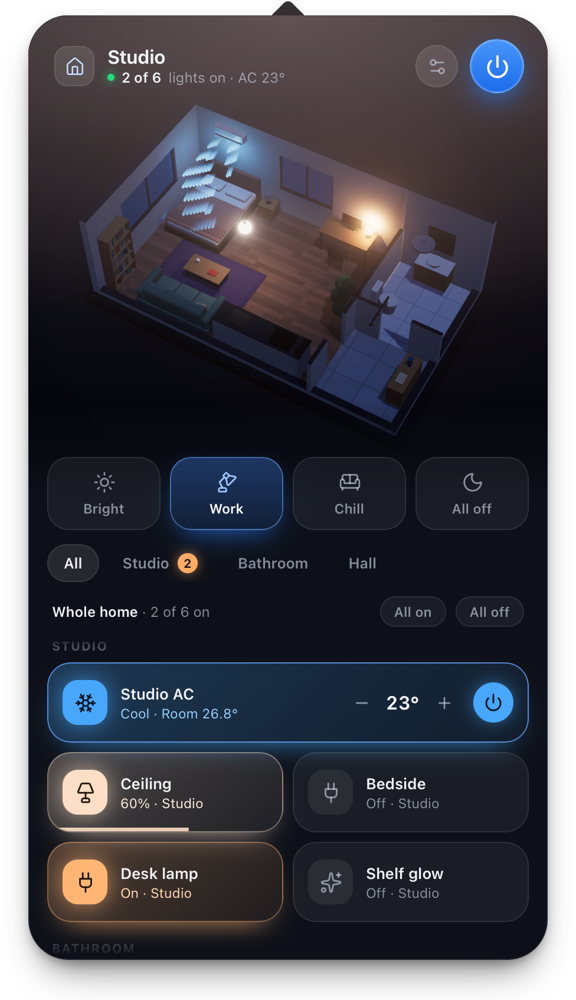

# The floor plan file

A home is one JSON document. The 3D scene, the panel and the editor are all built from it, so swapping the
file swaps the home.

- Your plan: `~/Library/Application Support/HouseControl/plan.json`
- Bundled demos: [`web/public/plans/home.json`](../web/public/plans/home.json),
  [`studio.json`](../web/public/plans/studio.json) and, on two floors, [`house.json`](../web/public/plans/house.json)

You rarely need to write it by hand — **Edit Home…** does it for you — but it is plain, stable and easy to
generate or version. Load a file with **Load Floor Plan…** in the menu bar icon's right-click menu, or with
**Import…** in the editor.

<p align="center">
  
</p>

## Coordinates

Everything is in metres, seen from above: `x` grows to the right (east), `z` grows downwards (south).
Heights (`y`, `sill`, `head`) are metres above the floor. Angles are degrees.

## A complete small example

```jsonc
{
  "name": "Home",
  "wallHeight": 2.6,
  "interiorWallHeight": 1.25,
  "outdoorTemp": 29,
  "camera": { "azimuth": 34, "elevation": 47 },

  "rooms": [
    { "id": "living", "name": "Living", "rect": [0, 0, 6.4, 4.6], "floor": "oak" },
    { "id": "bath",   "name": "Bathroom", "rect": [6.4, 0, 2.2, 3.6], "floor": "tile" }
  ],

  "openings": [
    { "type": "door",   "from": [6.4, 1.0], "to": [6.4, 1.9] },
    { "type": "window", "from": [0, 1.0],   "to": [0, 2.6], "sill": 0.85, "head": 2.1 }
  ],

  "furniture": [
    { "type": "sofa", "pos": [3.9, 2.4], "rot": -90, "width": 2.5, "color": "#8b93a7" },
    { "type": "rug",  "pos": [2.6, 2.4], "size": [2.4, 1.6] }
  ],

  "lights": [
    { "id": "living.main", "name": "Ceiling", "room": "living", "type": "ceiling", "pos": [2.9, 2.3],
      "capabilities": ["brightness", "temp"] },
    { "id": "living.floor", "name": "Floor lamp", "room": "living", "type": "floor", "pos": [5.8, 0.6] },
    { "id": "living.tv", "name": "TV backlight", "room": "living", "type": "strip", "pos": [0.13, 2.3],
      "y": 1.05, "rot": 90, "length": 1.5, "capabilities": ["brightness", "color"], "color": "#7b5cff" }
  ],

  "acs": [
    { "id": "living.ac", "name": "Living AC", "room": "living", "wall": "west", "pos": [0, 0.8], "y": 2.2 }
  ],

  "scenes": [
    { "id": "movie", "name": "Movie", "icon": "film",
      "lights": { "*": { "on": false }, "living.tv": { "on": true, "brightness": 0.9, "color": "#6a4cff" } },
      "acs": { "*": { "target": 23 } } }
  ]
}
```

## Top level

| Field | Default | Meaning |
| --- | --- | --- |
| `name` | `"Home"` | Shown in the panel header |
| `wallHeight` | `2.6` | Height of the outer walls |
| `interiorWallHeight` | `1.25` | How much of the inner walls is drawn, so they do not hide the rooms |
| `outdoorTemp` | `27` | Used to estimate the room temperature of an AC that has no sensor |
| `camera.azimuth`, `camera.elevation` | `34`, `47` | Default view. Walls facing the camera are cut away, so the azimuth decides which side is open |
| `levels` | one floor | The floors of a home on several, lowest first. See [Floors](#levels-floors) |

## `levels`: floors

A home on one floor needs nothing here. A house on several lists its floors, lowest first:

```jsonc
"levels": [
  { "id": "ground", "name": "Ground floor" },
  { "id": "upper",  "name": "First floor", "wallHeight": 2.5 }
]
```

| Field | Meaning |
| --- | --- |
| `id` | Unique. Rooms, furniture and openings refer to it with `"level"` |
| `name` | Shown on the floor buttons of the panel and the editor |
| `wallHeight` | Optional: this floor's own wall height (the home's `wallHeight` otherwise) |

Every room, piece of furniture and opening then says which floor it is on with `"level": "<id>"`; without it, it
is on the first. Lamps and ACs are on their room's floor. All floors share one grid, so a room upstairs at
`[0, 0, 4, 3]` sits right above the room at `[0, 0, 4, 3]` downstairs. Each floor stands on the one under it
(its walls plus a 30 cm slab); the 3D view shows one floor at a time, with the floors under it, and the editor
draws the floor below faintly so walls and stairs line up. Stairs are furniture on the lower floor
(`"type": "stairs"`).

## `rooms`

| Field | Meaning |
| --- | --- |
| `id` | Unique. Lights and ACs refer to it |
| `name` | Shown in the room filter |
| `rect` | `[x, z, width, depth]` |
| `floor` | `oak`, `walnut`, `tile` or `stone` |
| `level` | The floor (storey) it is on, on a home with [several](#levels-floors) |
| `part` | *ha-devices fork.* The `id` of another room this rectangle belongs to (see below) |

Rooms are rectangles. Where two of them touch, an inner wall appears on its own; make an L-shaped room out of two.

In the ha-devices fork, the second rectangle can say `"part": "<id of the first>"`. It keeps its own floor and
walls but is not a room of its own: no name, no tab in the panel, no group of devices. Its name is the main room's,
lamps, ACs and sensors placed in it belong to the main room, and focusing the room frames all of its pieces.

```jsonc
{ "id": "hall",       "name": "Hall", "rect": [6.45, 1.75, 1.75, 4.62], "floor": "stone" },
{ "id": "hall_top",   "part": "hall", "rect": [8.2, 1.75, 1.2, 1.7],    "floor": "stone" }
```

## `openings`

A gap in a wall, given by its two end points on that wall. It must be horizontal or vertical.

| Field | Meaning |
| --- | --- |
| `type` | `door`, `window`, or `open` (a doorway without a door, or a missing piece of wall) |
| `from`, `to` | `[x, z]` end points |
| `sill`, `head` | Bottom and top of a window. Defaults `0.85` and `2.1` |
| `level` | Its floor, on a home with [several](#levels-floors) |

## `furniture`

Decoration only. Every piece has `type`, `pos` (`[x, z]` of its centre), an optional `rot` and, on a home with
[several floors](#levels-floors), its `level`.

| `type` | Extra options |
| --- | --- |
| `sofa` | `width`, `color` |
| `armchair` | `color` |
| `coffeeTable` | `width` |
| `rug` | `size` (`[width, depth]`), `color` |
| `tv`, `sideboard`, `dresser`, `desk`, `vanity` | `width` |
| `diningSet` | `width`, `chairs` |
| `island` | `width`, `stools` |
| `kitchen` | `width`, `upper` (wall cabinets, `true` by default) |
| `bed` | `width`, `color` |
| `wardrobe`, `bookshelf` | `width`, `height` |
| `plant` | `height` |
| `stairs` | `width`, `depth` (its length), `height` (up to the floor above by default). They climb away from the front |
| `fridge`, `nightstand`, `bathtub`, `toilet` | — |

## `lights`

| Field | Meaning |
| --- | --- |
| `id` | Unique |
| `name` | Shown on the tile |
| `room` | The `id` of its room |
| `type` | `ceiling`, `pendant`, `spots`, `floor`, `table` or `strip`; in the ha-devices fork also `downlights` and the [appliances](#appliances-ha-devices-fork) `towelRail`, `fan`, `kettle`, `blind`, `vacuum` |
| `pos` | `[x, z]` |
| `y` | Height, if the default for the type does not fit |
| `rot` | Rotation, for strips and spots |
| `length` | Length of a `strip` |
| `capabilities` | Any of `brightness`, `temp`, `color`. Leave it out for a plain smart plug that only switches |
| `color` | Initial colour of a colour light |
| `link`, `tuya` | Link to a real device — see below |
| `points` | *ha-devices fork*, `downlights` only: `[[x, z], ...]` — every recessed spot on this one switch |
| `paths` | *ha-devices fork*, `strip` only: `[[[x, z], [x, z], ...], ...]` — a light line of several straight runs on one switch, in place of `pos`, `rot` and `length` |
| `power` | *ha-devices fork.* The `id` of the light whose switch feeds this one (see below) |
| `sensor` | *ha-devices fork.* A thermometer of the device, shown on its tile (the water in a kettle) |

### Downlights, light lines and shared switches (ha-devices fork)

**`downlights`** is a group of recessed spots on one switch. Each spot in `points` is drawn where it is, and the
group is one tile and one device. `pos` defaults to the middle of the spots. However many spots there are, at most
three light sources light the room, so a room of eight costs what three lamps do.

```jsonc
{ "id": "living.spots", "name": "Spots", "room": "living", "type": "downlights",
  "points": [[0.95, 0.7], [2.06, 0.7], [3.02, 0.7], [3.97, 0.7]],
  "link": { "service": "homeassistant", "id": "switch.living_spots" } }
```

**`paths`** draws a `strip` that turns a corner or runs in several pieces, all on one switch:

```jsonc
{ "id": "hall.line", "name": "Light line", "room": "hall", "type": "strip", "y": 2.62,
  "paths": [[[6.99, 2.73], [6.99, 5.03]], [[8.99, 2.51], [7.68, 2.51], [7.68, 6.3]]] }
```

**`power`** is for smart lamps behind an ordinary wall switch, such as track heads on the same switch as the
ceiling spots. When the switch is off, the lamps behind it are dark and get no commands. Switching it on brings
them on too. Tapping one of them while the switch is off closes the switch first and turns the lamp on a few
seconds later, once it has power. A lamp cannot feed another lamp that is itself fed.

```jsonc
{ "id": "kitchen.track1", "name": "Track 1", "room": "kitchen", "type": "spots", "pos": [2.35, 5.22],
  "capabilities": ["brightness", "temp"], "power": "kitchen.spots",
  "link": { "service": "homeassistant", "id": "light.track_1" } }
```

## `acs`

| Field | Meaning |
| --- | --- |
| `id`, `name`, `room` | As for lights |
| `type` | *ha-devices fork.* `wall` (the default) or `floor` for underfloor heating (see below) |
| `wall` | The wall it hangs on: `north`, `south`, `east` or `west`. Not used by `floor` |
| `pos` | `[x, z]`, on that wall |
| `y` | Height. Default `2.2` |
| `min`, `max` | Range of the target temperature. Defaults `16` and `30` |
| `link`, `tuya` | Link to a real device — see below |
| `sensor` | A thermometer for the room — see below |

**Underfloor heating (ha-devices fork).** `"type": "floor"` is a thermostat for the whole room instead of a unit
on a wall. It needs no `pos` or `wall`; the heating loop is drawn on the room's floor and glows while it heats.
`min` and `max` default to `5` and `35`. A scene's `"*"` and the panel's summary leave it alone: only a scene that
names it changes it.

```jsonc
{ "id": "bath.floor", "name": "Floor heating", "room": "bath", "type": "floor",
  "link": { "service": "homeassistant", "id": "climate.bathroom_floor" } }
```

## Appliances (ha-devices fork)

Appliances are lights in the plan (they live in `lights`, switch on and off and can be linked the same way), but
they are not lighting:

- **Light on / Light off** in the panel and a scene's `"*"` leave them alone; only a scene that names one changes it.
- They are not counted as lamps. A room's badge does count a running appliance, so a kettle that is on shows on
  its room's tab. An open blind is not counted as running.

| `type` | Model | Options | Level |
| --- | --- | --- | --- |
| `towelRail` | Heated towel rail on a wall; the bars glow when it heats | `rot` (front into the room, as for furniture), `y` (bottom, default `0.75`), `width` (`0.5`), `height` (`0.8`) | on / off |
| `fan` | Extractor fan in the ceiling; the blades turn while it runs | `y` | on / off |
| `kettle` | Kettle on a worktop; the base glows while it boils | `y` (height of the worktop, default `0.9`) | on / off |
| `blind` | Roller blind on a window | `rot`, `y` (top of the window, default `2.1`), `width` (`1.2`), `height` (drop when closed, `1.25`) | how far it is open: `on` is open, `brightness` is the position |
| `vacuum` | Robot vacuum on its dock; the ring glows while it cleans | `rot` | on = cleaning, off = back to the dock |

```jsonc
{ "id": "bath.towel", "name": "Towel rail", "room": "bath", "type": "towelRail", "pos": [7.95, 0.02],
  "link": { "service": "homeassistant", "id": "switch.towel_rail" },
  "sensor": { "service": "homeassistant", "id": "sensor.towel_rail_temperature" } }
```

## `sensors` and `outdoor`: climate (ha-devices fork)

The temperature and humidity of each room, and what is known about outside:

```jsonc
"sensors": [
  { "room": "living", "temperature": "sensor.living_temperature", "humidity": "sensor.living_humidity" },
  { "room": "bath",   "temperature": "sensor.bath_temperature",   "humidity": "sensor.bath_humidity" }
],
"outdoor": {
  "weather": "weather.forecast_home",          // temperature, humidity, pressure and the sky
  "pressure": "sensor.living_pressure"         // optional: a sensor of your own wins over the forecast
}
```

| Field | Meaning |
| --- | --- |
| `sensors[].room` | The room (a room's `part` counts as the room) |
| `sensors[].temperature`, `sensors[].humidity` | Entity ids; either may be left out |
| `outdoor.weather` | A `weather.*` entity |
| `outdoor.temperature`, `outdoor.humidity`, `outdoor.pressure` | Optional `sensor.*` entities that replace the forecast's values |

The values are shown as chips over the rooms in the 3D view (a button beside the model hides them), next to each
room's heading in the panel, and as a line under the home's name: outside temperature, humidity, sky and the
pressure in mmHg. A room more humid than 65 % or drier than 30 % is highlighted.

## `scenes`

| Field | Meaning |
| --- | --- |
| `id`, `name` | Unique id and the label of the button |
| `icon` | `sun`, `sofa`, `film`, `moon`, `door`, `table`, `bed`, `tv` or `sparkles` |
| `lights` | Light id → what to set: `on`, `brightness` (0–1), `temp` (2200–6500 K), `color` (`#rrggbb`) |
| `acs` | AC id → what to set: `on`, `target`, `mode` (`cool`, `heat`, `dry`, `fan`, `auto`), `fan` (`auto`, `low`, `medium`, `high`, `turbo`) |

In both maps the key `"*"` applies to every device, and a device's own entry overrides it.

## Linking real devices

A light or an AC becomes real when it is linked to a device of a connected platform. The editor fills the link
in when you pick a device under **Real device**; by hand it looks like this:

```jsonc
// Home Assistant (an entity id), Philips Hue (the bridge's light id), Apple Home (HomeKit's service id)
{ "id": "living.floor", "name": "Floor lamp", "room": "living", "type": "floor", "pos": [5.8, 0.6],
  "link": { "service": "homeassistant", "id": "light.floor_lamp" } }

// An AC with a thermometer from any platform for its room temperature
{ "id": "living.ac", "name": "Living AC", "room": "living", "wall": "west", "pos": [0, 0.8],
  "link": { "service": "homeassistant", "id": "climate.living_room" },
  "sensor": { "service": "hue", "id": "<id of a Hue motion sensor's thermometer>" } }

// Smart Life keeps its own object
{ "id": "bed.ac", "name": "Bedroom AC", "room": "bedroom", "wall": "north", "pos": [2, 0],
  "tuya": { "deviceId": "<device id>", "sensorId": "<id of a Smart Life temperature sensor in the room>" } }
```

| Field | Meaning |
| --- | --- |
| `link.service` | `homeassistant`, `hue` or `homekit` |
| `link.id` | The device on that platform |
| `sensor` | ACs only, optional: `{ "service", "id" }` of a temperature sensor whose reading is shown as the room temperature. A simulated AC can have one too |
| `tuya.deviceId` | The Smart Life device |
| `tuya.sensorId` | ACs linked to Smart Life only, optional: a Smart Life temperature sensor |
| `tuya.codes.switch` | Optional: the data point that switches the device, when it is not the usual one — e.g. `"switch_2"` for the second gang of a double switch |

Devices without a link stay simulated, so a plan can mix real and imaginary ones, and one home can mix
platforms: Hue lamps, a Home Assistant air conditioner and a Smart Life plug side by side.

Device IDs identify your hardware. Remove the `link`, `sensor` and `tuya` objects before you share a plan.

## Errors

A plan that does not add up — an unknown room, a duplicate id, an opening that is not axis-aligned — is not
rendered half-way: the panel says what is wrong and where, and the editor shows the same in its status bar.
